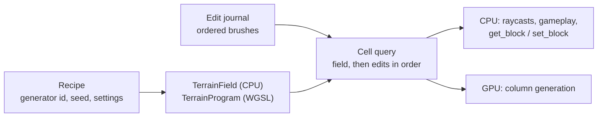
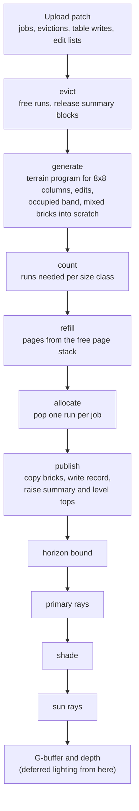
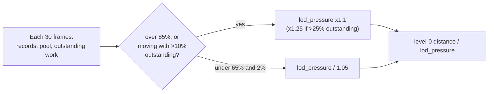

You start in orbit. The planet is a disc of green and brown under a thin blue limb. You dive. A continent becomes a valley, the valley becomes a ridge, and the ridge becomes blocks you can count. Every one of those blocks is 10 cm across. You land, pick one up, and the hole stays there.

There is no mesh anywhere in this pipeline. No marching cubes, no smoothed surface pretending to be voxels from far away. Every pixel of terrain is a ray that hit a cell.

Here is the scale problem in one line. Fill an Earth-radius sphere with 10 cm cubes at one byte each:

$$
N = \frac{\tfrac{4}{3}\pi R^3}{s^3} = \frac{\tfrac{4}{3}\pi\,(6.371\times10^6\,\mathrm{m})^3}{(0.1\,\mathrm{m})^3} \approx 1.08\times10^{24}\ \text{cells}
$$

About a yottabyte. Nobody stores that. Helio stores a recipe and the list of things you changed, then builds only what the camera can see, at the size the screen can show.

---

## The World Is a Recipe and a Journal

A planet in Helio is two things. A terrain field, which answers "what is at this cell?" for any cell on the planet. And an ordered journal of brushes, the digs, builds and paints you made.



The field is integer arithmetic end to end. Noise, height, strata, material choice, edit containment. The CPU and the GPU run the same program and must agree on every cell, bit for bit, because gameplay asks the CPU and the player sees the GPU. A float in the field would make them disagree at some cell on some face eventually, and the player would walk into a block the renderer says is air. So there are no floats in the field, and a GPU test compares both sides.

The generator is a height field. It decides a surface height and a ground material per column, plus strata below. Generated caves are out of scope. Dug caves are not: a brush is a local change, and the journal can carve anything.

A brush is small: a shape (sphere or cube), an operation (remove, add, paint), a centre and a size. Saving a world saves the recipe and the brush list. A dig is a few dozen bytes.

---

## Cells on a Planet

A Cartesian grid wrapped around a sphere tears at the poles. Helio makes the grid itself planetary.

The planet is a cube sphere: six faces, each split by planes through the planet centre at equal angles. Height is counted in radial layers from a datum. A cell is addressed by `(face, i, j, k)`, with integer indices and nothing else. For an Earth face at 10 cm that is about 1.25 × 10⁸ cells across, which still fits in integer math.

```text
            +-------+
            |  +Y   |
    +-------+-------+-------+-------+
    |  -X   |  +Z   |  +X   |  -Z   |      six faces, one address space
    +-------+-------+-------+-------+      (face, i, j, k)
            |  -Y   |
            +-------+

   one face, side view:          k (radial layer)
                                 ^
        planes through the       |   . . . . . . .   air
        centre split i and j     |  ###############  surface
        at equal angles          |  ###############  solid
                                 +-----------------> i
```

Levels make it multiresolution. A level-L cell is 2ᴸ base cells wide and tall. Eight by eight cells of one level form a column, and a column is the unit of everything that follows: streaming, generation, storage, tracing.

A column key packs face, level and the column index into 64 bits. A key does not mean the column exists. It is a name the residency system may or may not have filled.

Voxel size is authored per world, from 0.1 m to 1 m. The shape of the terrain stays the same across voxel sizes. A finer grid samples the same field more densely, so a 1 m world and a 10 cm world have the same mountains.

---

## What a Column Holds

Most of a terrain column is boring. Solid rock below, air above, and a thin band where the surface wanders through. Helio stores exactly that shape.

```text
      column (8 x 8 cells wide), seen from the side

      k  ^
         |   air           <- nothing stored, everything above `top` is empty
   top --|. . . . . . . .
         | [ mixed brick ] <- 8x8x8 occupancy bits (64 bytes)
         | [ mixed brick ]
         | [ solid brick ] <- one bit in a mask, no storage
  k_lo --| [ mixed brick ]
         |   solid         <- everything below the band is solid
         +---------------->
```

A record is 32 bytes: the key, `k_lo` (the lowest band brick), counts, a size class, the start of its run in the brick pool, two 32-bit masks saying which band bricks are mixed and which are fully solid, and an edit-list reference. Only mixed bricks take pool space, 64 bytes each.

Tops matter more than anything else in the record. A column's top must bound every solid cell in it and should be tight. An early version clamped the generated band top to the datum, `max(top, 0)`. Below sea level every column then claimed about 30 m of empty air. Rays stepped cell by cell through it, 137 steps per ray instead of 6, and columns stored empty bricks. Tops are allowed to be loose by at most seven cells, a 3-bit gap kept in the record.

---

## Residency Follows the Camera

The renderer keeps a moving, nested neighbourhood around the eye. Each level wants a disc of columns. Level 0 reaches the distance where its cells are about a pixel wide. Each coarser level reaches about twice as far.

```text
      top view, one face

      +-----------------------------------+
      |  level 3                           |
      |      +-----------------------+     |
      |      |  level 2              |     |
      |      |     +-----------+     |     |
      |      |     |  level 1  |     |     |
      |      |     |   +---+   |     |     |
      |      |     |   | 0 |   |     |     |   each ring: cells ~1-2 px wide
      |      |     |   +---+   |     |     |   at its edge
      |      |     +-----------+     |     |
      |      +-----------------------+     |
      +-----------------------------------+
```

A level is only switched on if terrain within its reach can come near the eye. The window worker bounds the terrain around the eye per level, with a branch and bound over column tops. Over a meadow a kilometre below, the 10 cm level stays off. The first version used the planet's highest peak as the bound. It kept the finest level on below about 5 km everywhere, and a cruise at 1.2 km streamed 180,000 columns a second of terrain nobody could see.

The window worker runs on its own thread. It turns an eye position into per-level diffs: columns to add, columns to remove. The render thread applies those diffs inside a CPU budget, admits pending columns nearest first, and hands the GPU one patch per frame.


A column that is wanted but not resident yet is not a hole. The tracer falls back to the next coarser level, which is always there. Streaming is allowed to lag. It is never allowed to leave the ground missing.

The GPU job budget is measured, always. Every frame converts a GPU time target (1.5 ms moving, 6 ms still) into a job count by dividing by the measured cost per column. Timestamps arrive frames late, so each sample is paired with the job count of the frame it measured. Using the latest frame's count instead was off by 2 to 7 times. On an RTX 3060 a column costs about 0.22 µs to generate, so a moving frame can issue around 6,500 jobs.

---

## A Frame on the GPU



The brick pool is one big buffer cut into 512-unit pages. A column needs a contiguous run of one header unit plus its mixed bricks, rounded up to a power of two. Each size class owns pages and keeps a stack of free runs. Allocation is two atomics per job and never touches the CPU.

```text
   pool:  | page 0 | page 1 | page 2 | page 3 | ... | page 8191 |
             class 3  class 0  class 5  free

   class 3 page:  [run][run][run]...[run]   64 runs of 8 units
   free stacks:   class 0: ...  class 3: page0+16, page0+40, ...
```

---

## Following One Pixel

Everything the tracer touches is relative to the eye. The eye position lives in f64 on the CPU, its face indices stay integers, and only small offsets reach the shader as f32. Far from the origin a planet coordinate is around 6.4 million metres, and an f32 has a step of half a metre there. Adding a 50-million index into an f32 before subtracting it lost the position inside a voxel. Subtracting in integers first keeps it.

A ray picks its level from distance. The switch distance is dithered per column, hashed from the column's key, so a column changes level at its own stable distance. Per-pixel dither flickered while moving. Per-frame dither crawled.

Then the ray repeatedly jumps out of the largest box it can prove empty:

```text
   sky bound        a directional table: per azimuth sector and distance,
                    the lowest elevation that clears all resident terrain
   summary block    4x4, 16x16, 64x64 columns: above their top -> skip all
   column top       above it -> skip the column
   air / solid      brick mask says empty -> skip the brick
   mixed brick      only here: exact cell DDA over 512 occupancy bits
   missing column   drop one level and continue
```

Every one of those shortcuts is a promise about every solid cell under it. A sky bound that lies by one cell cuts the top off a mountain on the limb. Each acceleration has a test that renders with and without it and compares, and the primary ray carries a fail-safe: a ray the sky bound ended that still points into the terrain shell keeps going.

Shading reads materials from the generator or the edit that owns the cell, filters appearance for cells about a pixel wide, and computes ambient occlusion from neighbour occupancy. One shadow ray per 2×2 block, shared with the other pixels when they sit on the same surface. Then it writes a regular G-buffer, depth-tested against meshes, and deferred lighting takes it from there. The terrain is just another surface in the frame.

---

## When the Ground Stopped Refining

This is the bug that shaped the last round of work.

In the editor, after a minute of hard flying (climb, dive, turn, repeat), the terrain stopped refining. Big blocks everywhere. Stopping the camera did not help. The test harness flew similar routes and never saw it.

The harness rendered at 1280×720. The editor viewport was much larger. Resident columns grow with the pixel count, because the level-0 distance does:

| view | resident columns | pool used |
|---|---|---|
| 720p ground | 0.66 M | 30% |
| 1440p ground | 1.73 M | 80% |
| editor viewport (from its logs) | 2.77 M | over 100% |

The record capacity was 3 million. Every fixed limit was waiting for the editor and none of them showed at 720p.

Once the harness ran at 2560×1440, the stall reproduced on the first try, and it was four problems stacked on top of each other.

**Diffs queued faster than they applied.** The render thread asked the worker for a new plan every frame the camera moved. Each plan came back as a diff per level. At 1440p the diffs are four times larger, and climbing fast produced them faster than the CPU budget could apply them. The queue grew to over 3,000 level diffs and never shrank. Evictions and admissions worked through windows the camera had left seconds ago. After the dive back down, 100% of terrain pixels came from coarse cells, the widest 623 px across.

The fix is coalescing. A new plan is requested only after the previous one is applied. The worker diffs against the last window it sent, so one diff covers all the motion since. The queue now stays under about 30.

```text
   before:  eye moves -> plan -> diff -> queue (grows without bound)
            eye moves -> plan -> diff -> queue
            eye moves -> plan -> diff -> queue ...

   after:   eye moves -> plan -> diff -> apply ... done
                         (eye kept moving)
            eye moves -> plan(all motion since) -> diff -> apply
```

**Failures were lost.** Column jobs can fail: scratch space full, pool full. Results came back through four readback buffers, and when all four were busy the frame assumed success. A failed column then stayed resident on the CPU, unpublished on the GPU, and was never retried. A permanent hole, papered over by a coarse level. Now failed jobs append their keys to a GPU list that is copied back with the allocator counters, and a frame with no free readback issues no jobs at all. Every outcome reaches the CPU.

**Pages never came back.** Size classes took whole pages from the free stack and kept them forever. Flying from plains into mountains changes the size mix, so pages sat stranded in classes the terrain no longer used. Each page now counts its free runs. Under pool pressure a recycle pass returns wholly free pages to the free stack and compacts the class stacks. No live run moves.

**The table outgrew the lookup.** The GPU finds a column by linear probing and gives up after 64 slots. The CPU had no such limit. Past about 2.5 million columns in a 4-million-slot table, probe runs passed 64 and some columns became invisible to the GPU. The table is now 8 million slots, and the CPU refuses to place a column beyond the GPU's reach.

Fixing those four made the system stop dying. It did not make it fast enough. At 1440p with 10 cm cells, flying at 90 m/s near the ground churns about 100,000 columns a second through the windows. Admission is CPU-bound at roughly 1,500 to 3,000 columns per frame. Churn grows with resolution squared times speed. Throughput does not.

So the last piece is LOD pressure. When records or pool pass 85%, or when more than 10% of the wanted columns are outstanding while moving, the level-0 distance shrinks a step. Churn falls with the square of that factor. The view stays complete one step coarser instead of falling back several levels, and when the backlog clears the distance recovers. A still camera never raises it: a backlog at rest is loading, not churn.



Same 150-second route at 2560×1440, before and after:

| | before | after |
|---|---|---|
| terrain pixels in cells wider than 4 px, mean while flying | 56.9% and rising | 12.6% |
| widest enlarged cell | 623 px | 17 px |
| queued window diffs | 3,339 and growing | 28 at most |
| after stopping | never recovered | refined in 2.0 s |

The lesson that stuck: test at the resolution people use. Every one of those limits was invisible at 720p.

---

## Edits Are Part of the Terrain

A dig in the viewport and a `set_block` from a script land in the same journal. The CPU answers queries by evaluating the field and then the brushes that touch the cell, in order. Later brushes win.

On the GPU, a brush becomes face brushes on each cube face it touches, and resident columns under it are queued for regeneration. Each column carries a short list of the edits that overlap it. Generation evaluates the field for its 8×8 footprint, then applies that list. Nothing else on the planet does any work.

```text
   brush (sphere, remove) at world position P
      -> face brushes on every face it overlaps
      -> resident columns it touches, at every level -> urgent regeneration
      -> each column: edit list = brushes overlapping its footprint
      -> generate: field, then edits in journal order
```

A destruction test lays 17,600 block edits and compares every pixel against a CPU raycast. Zero mismatches.

---

## What Is Still Open

Admission is the next bottleneck. It runs on the render thread at about 1 to 2 µs per column, spread over hash lookups, summary-block references and edit queries. Moving it off the render thread is the real fix for fast flight at high resolution. LOD pressure is the safety net until then.

Pending columns get their priority when a plan is made. Once admission lags, columns near the old eye position go first. Re-prioritising against the current eye would help exactly in the cases pressure covers today.

The art is early. The palette, grass colours and per-voxel pigment are configurable per terrain now, and the planetary sky follows the radial horizon from any point on the planet, including orbit. Getting the look of a hand-painted landscape out of 10 cm cells from orbit to ground is the next stretch.
